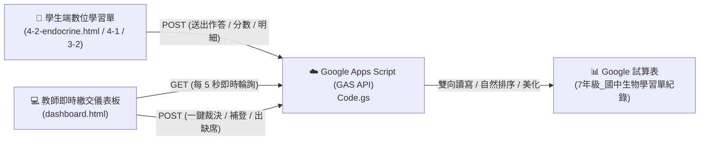
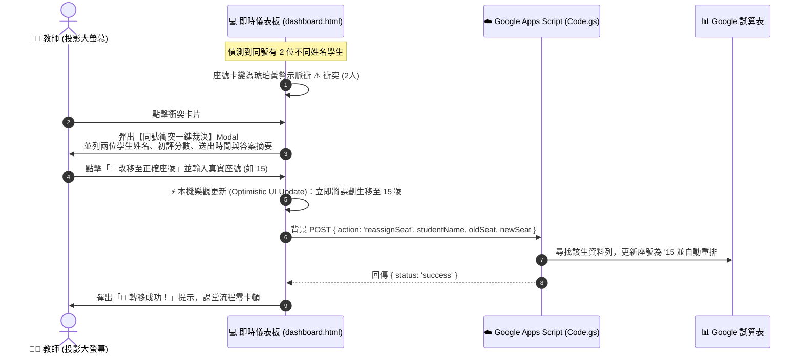

# 🧬【國中生物】數位互動學習單平台 專案架構與維護總手冊 (2026 旗艦版)

> **本手冊定位**：本文件為【國中生物】數位互動學習單平台（Bio Learning Sheets Hub）之**全端技術架構、教師即時儀表板、Google 試算表雙向同步、同號衝突一鍵裁決與長期維護指南**。  
> **跨對話交接原則**：未來無論何時在新對話視窗中啟動本專案維護，只需對 AI 助手發送指令：  
> `「請先閱讀【國中生物】數位學習單專案架構與維護總手冊.md，並依循規範繼續開發維護」`，AI 即可 100% 掌握全站規範與即時連動機制。

---

## 一、專案總覽與全端技術架構

本平台專為國中七年級生物正課（包含神經系統、內分泌系統、循環系統、恆定性與生殖遺傳）打造，採用 **Serverless 無伺服器純前端 + Google Apps Script (GAS) 雙向雲端串接**：



### 1. 核心網址與部署資訊
- **學生端線上入口**：`https://zeroseven-hue.github.io/bio-endocrine-worksheet/`
- **教師即時儀表板**：`https://zeroseven-hue.github.io/bio-endocrine-worksheet/dashboard.html`
- **GitHub 倉儲**：`https://github.com/zeroseven-hue/bio-endocrine-worksheet`
- **Google 試算表**：`https://docs.google.com/spreadsheets/d/1UgvWTD109MPFBxUKN-8RZCUpZ2ysFaKrTN5zeW3yAks/edit`
- **GAS 後端 API 部署端點**：  
  `https://script.google.com/macros/s/AKfycby2-Pj2Nz1NFonB11rtsHXMMGU2qxLxvbjV0KCu4pi4oNXv2QLp0tK8m1XNYWvlCRJoEA/exec`
- **教師安全解鎖 PIN 碼**：預設為 `8088`（儲存於 `localStorage: teacher_global_pin`）。

---

## 二、檔案目錄結構與各檔案核心職責

```
Bio01_4-2內分泌系統/
├── index.html                   # 學習單總入口導引頁（卡片式單元選擇）
├── dashboard.html               # 🌟 教師即時繳交儀表板（5秒輪詢 / 衝突一鍵裁決 / 35卡矩陣）
├── 3-2-circulation.html         # 【單元 3-2】人體的循環 數位互動學習單
├── 4-1-nervous.html             # 【單元 4-1】神經系統 數位互動學習單
├── 4-2-endocrine.html           # 【單元 4-2】內分泌系統 數位互動學習單
├── circulation.js               # 3-2 專屬計分與任務邏輯
├── nervous.js                   # 4-1 專屬計分與神經反射測驗邏輯
├── game.js                      # 4-2 專屬計分與腺體圖互動邏輯
├── style.css                    # 學習單主視覺樣式（科技藍調 HUD、抗日光燈白底高對比）
├── Code.gs                      # 🌟 後端 Google Apps Script API 原始碼
├── 【國中生物】數位學習單專案架構與維護總手冊.md # 本架構總手冊
└── assets/
    ├── css/hub.css              # 大廳與儀表板共用樣式庫
    └── js/common.js             # 站台共用常數 (COURSE_CONFIG)、導航與剪貼簿工具
```

---

## 三、國中現場資料規範標準 (七年級生物)

1. **班級陣列**：`701` 至 `710`（共 10 班）。
2. **座號範圍**：國中現場標準 `01` 至 `35` 號（強制補零為 2 位數字元串）。
3. **組別選項**：`第 1 組` 至 `第 8 組`。
4. **座號防被數值抹除**：寫入 Google Sheets 時必須以單引號開頭（例如 `"'05"`、`"'10"`），防止 Google 試算表自動將其轉為數值抹除前導零。

---

## 四、教師即時儀表板技術規範 (2026 旗艦版)

### 1. 5 秒無感背景自動同步 (`AUTO_REFRESH_INTERVAL_SECONDS = 5`)
- **倒數膠囊按鈕**：頂部工具列提供 `🟢 即時同步 5s` 藥丸按鈕，秒數倒數即時遞減。
- **背景無感更新 (`isSilent = true`)**：自動輪詢時不顯示「讀取中」遮罩，也不會彈出任何警示視窗，畫面卡片自然更新。
- **智慧暫停防干擾**：當教師開啟任何彈窗（如同號衝突裁決 Modal、手動補登 Modal、PIN 解鎖 Modal）時，計時器自動暫停，關閉後即刻恢復。
- **隨時手動刷新**：點擊 `🔄 立即刷新` 可隨時手動強制自 GAS 撈取最新名單並重設倒數為 5 秒。

### 2. 多次繳交智能聚合 (同一學生重交)
- 若同一位學生因修改答案或想爭取更高分而提交多次（例如陳品謙同學分別在 13:40 得 75 分、13:43 得 85 分）：
  - 儀表板**自動抓取最新一筆分數（85分）**呈現在座號卡上。
  - 座號卡標記 `已交 (2次) ✅`，提醒老師該生有重交紀錄。
  - 點開作答詳情彈窗時，頂部以綠色區塊完整展示**「📜 本座號歷次提交紀錄時間軸」**，明列各次繳交時間與初評得分。

### 3. 全班 100% 到齊即時彩蛋徽章
- 當繳交人數達到全班實到應交人數時，頂部達成率顯示：  
  `100% 🎉 全班到齊全數繳交！`（翠綠高對比動態徽章），激勵全班課堂氛圍。

### 4. 複製未交名單智慧整合
- 點擊 `📋 複製未交名單`，若班級內存在未裁決的同號衝突，通報訊息自動追加：  
  `• ⚠️ 誤劃同號待確認：10 號 (學生A / 學生B)`，讓老師或小老師一目了然。

---

## 五、試算表嚴格保全機制 (絕不覆蓋他人)

在傳統試算表覆蓋機制中，若學生 A 誤劃成學生 B 的座號，學生 B 辛苦完成的作業將被覆蓋毀損。生物平台全面實裝【姓名絕對保全機制】：

| 繳交情境 | 比對規則 | 試算表處理行為 | 儀表板呈現 |
| :--- | :--- | :--- | :--- |
| **同一學生再次提交** | 同班級 ＋ 同座號 ＋ **同姓名** | 原地更新該列 (`setValues`)，時間戳記與分數刷新 | 顯示最新分數，註記 `已交 (2次) ✅` |
| **不同學生誤劃同號** | 同班級 ＋ 同座號 ＋ **不同姓名** | **【絕對不覆蓋他人】**，直接新增一列 (`appendRow`) | 觸發琥珀黃呼吸光暈卡片：`⚠️ 學生A / 學生B` |
| **教師手動補登** | 標記為 `教師手動補登` | 以該座號為準進行就地補登或覆蓋 | 顯示手動補登成績並標記已完成 |

---

## 六、⚠️ 方案 B：同號衝突一鍵裁決系統 (免開試算表)

當出現不同學生填寫相同座號時，教師無須手動開啟 Google 雲端硬碟試算表：



### 教師裁決按鈕職責：
1. **「👑 確認為本號」**：確認選取同學為該座號主人，系統自動提示輸入另一位誤劃同學的真實座號進行轉移。
2. **「🔄 改移至正確座號」**：直接為誤劃同學輸入真實座號（01~35），系統自動發動樂觀更新與背景同步。

---

## 七、Google Sheets 後端自訂選單維護工具 (`Code.gs`)

開啟 Google 試算表時，上方功能表自動掛載**【🧬 生物學習單工具】**自訂選單：

### 1. `✨ 一鍵美化所有工作表 (套用科技藍調樣式)`
- 自動掃描所有「單元X作答紀錄」工作表。
- 套用科技深海藍表頭 (`#1E3A8A`)、白底與冰川淺藍 (`#F0F9FF`) 斑馬交替色彩。
- 將座號格式化為置中純文字 (`@`)，自動保留前導零。
- 自動依「班級升冪 ➜ 座號升冪」排序。

### 2. `🧹 智能清理重複繳交紀錄 (保留同名最高分，絕不覆蓋不同學生)`
- 專門應對課堂下課後的試算表整理。
- **嚴格保全原則**：僅合併清理「同班級 且 同姓名」的多餘重複列（保留最新/最高分）。
- 若同座號有不同姓名的學生，**絕對完整保留兩人資料**，留待教師親自核對，絕不誤刪任何學生！

---

## 八、未來新單元擴充與修改標準 SOP (How-To Guide)

當未來學期推進或新增生物單元學習單時，遵循以下 3 步即可無縫擴充：

### 步驟 1：新增單元 HTML 與 JS
1. 參考 `4-2-endocrine.html` 與 `game.js` 的結構，複製並命名為新單元檔案（例如 `4-3-homeostasis.html`、`homeostasis.js`）。
2. 在 JavaScript 提交函式中，設定 `sheetId: "4-3"`。

### 步驟 2：擴充 `assets/js/common.js`
在 `COURSE_CONFIG.units` 陣列中新增單元設定：
```javascript
{
  id: "4-3",
  file: "4-3-homeostasis.html",
  title: "【單元 4-3】體溫與水分恆定 數位互動學習單",
  badge: "上學期 · 恆定性",
  desc: "內溫外溫動物調節、皮膚微血管收縮舒張、排泄與水分恆定",
  status: "active"
}
```

### 步驟 3：儀表板與試算表自動適應
- `dashboard.html` 下拉選單將自動讀取 `COURSE_CONFIG.units` 生成新單元選項。
- 學生第一次送出該單元學習單時，後端 `Code.gs` 會自動在試算表中建立【單元4-3作答紀錄】工作表並自動美化排版，教師零負擔！

---

## 九、跨對話交接快捷指令句

當您在新的對話中需要維護或擴充國中生物學習單時，請直接向 AI 傳送：

> **「請閱讀【國中生物】數位學習單專案架構與維護總手冊.md，依照規範進行生物學習單的更新維護。」**

AI 即可立刻依循本手冊之規範，精確執行全端開發！
